# ha-router-card

[](https://www.home-assistant.io/integrations/marketplace/)
[](https://github.com/juju35/ha-router-card/actions/workflows/hacs.yml)
[](https://github.com/juju35/ha-router-card/actions/workflows/validate.yml)
[](https://github.com/juju35/ha-router-card/actions/workflows/lint.yml)
[](https://github.com/juju35/ha-router-card/releases/latest)
[](https://github.com/juju35/ha-router-card/blob/main/LICENSE)
[](https://buymeacoffee.com/julienstep9)

<p align="center">
  &nbsp;&nbsp;&nbsp;
  &nbsp;&nbsp;&nbsp;
  &nbsp;&nbsp;&nbsp;
  &nbsp;&nbsp;&nbsp;
  &nbsp;&nbsp;&nbsp;
  &nbsp;&nbsp;&nbsp;
  <br><br>
  &nbsp;&nbsp;&nbsp;
  &nbsp;&nbsp;&nbsp;
  &nbsp;&nbsp;&nbsp;
  &nbsp;&nbsp;&nbsp;
  &nbsp;&nbsp;&nbsp;
  
</p>

Lovelace cards for Home Assistant to monitor a **firewall**, a **router** or a **mesh Wi-Fi system** at a glance: WAN state, download / upload rates, CPU, RAM, temperatures, uptime, the mesh units and access points, connected clients and Wi-Fi networks. They work with **Firewalla**, **OPNsense**, **pfSense**, **UniFi**, **TP-Link Deco**, **Omada** and TP-Link routers, **MikroTik**, **ASUS**, **NETGEAR** (Orbi), **Keenetic**, **OpenWrt**, **GL.iNet**, **Xiaomi**, **eero**, **Linksys Velop** and **Ruckus Unleashed** ([list](#supported-integrations)), and with other router integrations whose entities say what they are; each section shows only what the integration exposes.

Entities are **discovered automatically**, you don't have to pick them one by one.

[](https://my.home-assistant.io/redirect/marketplace_repository/?owner=juju35&repository=ha-router-card&category=plugin)

| Router Card | Router Mini Card |
|---|---|
| 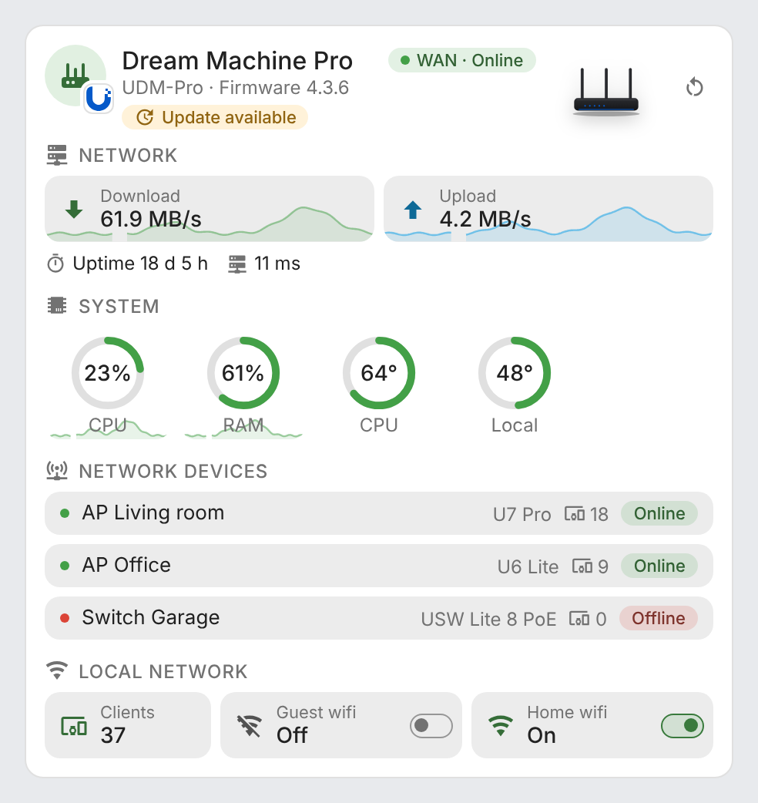 | 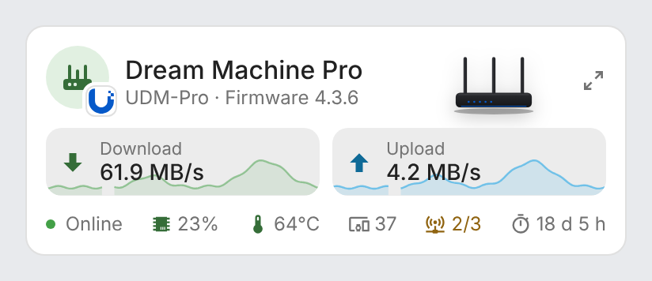 |

## Features

- Two cards: a full **Router Card** and a compact **Router Mini Card**
- Detail button at the top right of the mini card: it shows the full card in its place (same device and options), and the collapse button, or a click anywhere outside the card, brings the compact view back (`zoom: false` removes it)
- Automatic discovery of the router's entities, by the integration's own translation keys and attributes first, then by the kind of each entity (device class, unit) and the words of its key and entity id, in any language. An integration the card does not know still shows what it can recognise
- Header icon of the kind of device (firewall, router, mesh unit, access point) coloured with the WAN state like the status pill (green online, red offline, grey unavailable; the brand colour when the integration reports no WAN state), with the brand logo as a badge
- A drawing of the kind of device, in the brand's colour, opening the admin interface; model and firmware under the name; a chip when a firmware update is waiting
- Download / upload rates of the WAN, in bytes (kB/s, MB/s) or bits (kb/s, Mb/s), with their last 24 hours drawn behind each tile (recorder statistics), on the full card and the mini card
- WAN IP address, uptime, latency and packet loss, and the last speed test: the router's own (Firewalla, NETGEAR, Linksys Velop), else the [Speedtest.net](https://www.home-assistant.io/integrations/speedtestdotnet/) or [Fast.com](https://www.home-assistant.io/integrations/fastdotcom/) integration's, or another one set in `entities`
- System: CPU, RAM and disk usage gauges with their last 24 hours behind them (0-100 % scale), temperature gauges, fans, load average
- Mesh and network devices: every mesh unit, access point or switch of the router's integration, with its state and its clients (the main unit first on a mesh system)
- Local network: connected clients (with the wired / Wi-Fi / guest split when the integration gives it), and a tile per Wi-Fi network with a switch that turns it on, or off after a confirmation popup
- A restart button at the top right of the full card reboots the device, after a confirmation popup; shown only when the integration exposes it
- Colours turn orange / red when a threshold is crossed (CPU, RAM, disk, temperatures); every threshold can be set
- Sensors of your choice for the router's values and the speed test, in YAML or in the visual editor (the WAN interface of a MikroTik, say)
- Click any value to open its Home Assistant history (more-info dialog), the logo to open the brand's website
- Visual editor in the dashboard UI for both cards (no YAML needed)
- Light and dark mode, 22 languages (see [Translations](#translations))
- Unavailable entities (for example while the router restarts) are shown as unavailable, not as offline or Wi-Fi off; the restart button is disabled meanwhile
- Sections view: the full card needs at least 9 columns, the mini card 6; on a narrow card the picture gets smaller then hidden, and the status pill shows only its coloured dot
- Single file, no external dependency: the drawings and brand logos are embedded; only English is in it, the other languages are loaded when needed

## Supported integrations

Each section shows only what the integration exposes. Built-in integrations ship with Home Assistant; custom ones are installed from their repository.

### Firewalls

| Integration | Discovered |
|---|---|
| [Firewalla Local](https://github.com/ccpk1/firewalla-local-ha) (`firewalla_local`, custom) | CPU, RAM, uptime, WAN IP and online / total hosts (attributes of the System Status sensor), ping latency and packet loss, speed test, SSID switches, AP7 access points with their clients |
| [OPNsense](https://github.com/travisghansen/hass-opnsense) (`opnsense`, custom) | WAN interface traffic rates, gateway status, delay and loss, CPU, memory, filesystem, load average, boot time, temperatures, firmware update, trackers |
| [pfSense](https://github.com/travisghansen/hass-pfsense) (`pfsense`, custom) | Same as OPNsense |

### Routers

| Integration | Discovered |
|---|---|
| [UniFi Network](https://www.home-assistant.io/integrations/unifi/) (`unifi`, built in) | Gateway: WAN port bandwidth, CPU, memory, temperatures, uptime, WAN latency, clients, firmware update, restart; access points and switches with their state and clients; WLAN switches. Pick an access point to see it on its own |
| [TP-Link Omada](https://www.home-assistant.io/integrations/tplink_omada/) (`tplink_omada`, built in) | Gateway WAN link, CPU, memory, access points and switches with their state |
| [TP-Link router](https://github.com/AlexandrErohin/home-assistant-tplink-router) (`tplink_router`, custom) | CPU, memory, WAN IP and uptime, clients (wired, Wi-Fi, guest), Wi-Fi switches, restart, LTE rates |
| [MikroTik Router](https://github.com/tomaae/homeassistant-mikrotik_router) (`mikrotik_router`, custom) and [MikroTik](https://www.home-assistant.io/integrations/mikrotik/) (`mikrotik`, built in) | Rates and connection of the WAN interface (an interface named WAN, else set it in `entities`), CPU, memory, disk, temperatures, fans, uptime, wired / wireless clients, firmware update |
| [ASUSWRT](https://www.home-assistant.io/integrations/asuswrt/) (`asuswrt`, built in) and [AsusRouter](https://github.com/Vaskivskyi/ha-asusrouter) (`asusrouter`, custom) | Download / upload speed, CPU, memory, CPU and radio temperatures, boot time, load average, connected devices, WAN state and IP, Wi-Fi switches, restart |
| [NETGEAR](https://www.home-assistant.io/integrations/netgear/) (`netgear`, built in, Orbi included) | CPU, memory, speed test (downlink / uplink bandwidth, average ping), guest Wi-Fi switches, firmware update, restart |
| [Keenetic NDMS2](https://www.home-assistant.io/integrations/keenetic_ndms2/) (`keenetic_ndms2`, built in) | Connection state, trackers |
| [OpenWrt](https://github.com/kvj/hass_openwrt) (`openwrt`, custom), [OpenWrt (FaserF)](https://github.com/FaserF/ha-openwrt) (`openwrt`, custom), [OpenWrt ubus](https://github.com/FUjr/homeassistant-openwrt-ubus) (`openwrt_ubus`, custom) and [LuCI](https://www.home-assistant.io/integrations/luci/) (`luci`, built in, trackers only) | WAN rates, CPU, memory, load, uptime, wireless clients, mesh peers, Wi-Fi switches, as each integration exposes them |
| [GL.iNet](https://github.com/HarvsG/ha-glinet4-integration) (`glinet`, custom) and [GL.iNet Router](https://github.com/vithurshanselvarajah/ha-glinet-router) (`glinet_router`, custom) | WAN status, CPU temperature, load, memory, flash, uptime, clients, restart |
| [Xiaomi Mi Wi-Fi](https://github.com/dmamontov/hass-miwifi) (`miwifi`, custom) | WAN download / upload speed, memory, temperature, uptime, devices, Wi-Fi switches |

### Mesh Wi-Fi and access points

| Integration | Discovered |
|---|---|
| [TP-Link Deco](https://github.com/amosyuen/ha-tplink-deco) (`tplink_deco`, custom) | Total download / upload of the clients, internet state, CPU and memory (smoothed), every Deco with its state and clients, trackers |
| [eero](https://github.com/schmittx/home-assistant-eero) (`eero`, custom) | Public IP, connected clients, every eero with its state and clients |
| [Linksys Velop](https://github.com/uvjim/linksys_velop) (`linksys_velop`, custom) | WAN status and IP, online devices, speed test, every node with its state and clients |
| [Ruckus Unleashed](https://www.home-assistant.io/integrations/ruckus_unleashed/) (`ruckus_unleashed`, built in) | Clients (trackers) |

### Any other integration

Set `device` to the device id of a router, firewall or access point of another integration (the device page's address ends with it): the card recognises its entities by their kind and their names (`download` / `rx` / `in`, `cpu`, `memory`, `uptime`, `wan`, `clients`…) and shows what it finds, in the integration's neutral colours. Open an issue to add the integration's branding and anything the card misses.

## Installation

### Via the Marketplace (recommended)

Click the button below to add the repository directly:

[](https://my.home-assistant.io/redirect/marketplace_repository/?owner=juju35&repository=ha-router-card&category=plugin)

Then click **Install**, and reload your browser when the Marketplace asks you to.

Or manually:

1. Open **Settings → Marketplace → Add from link** (top right; this needs a GitHub account connected)
2. Add `https://github.com/juju35/ha-router-card` — Type: **Dashboard**
3. Open **Router Card** and click **Install**
4. Clear your browser cache and refresh

### Manual

1. Download `router-card.js` and the `router-card.i18n.*.js` translation files from the [latest release](https://github.com/juju35/ha-router-card/releases/latest)
2. Copy them all to `/config/www/` (without the translation files, the cards show in English)
3. Go to **Settings → Dashboards → ⋮ → Resources** → Add resource:
   - URL: `/local/router-card.js`
   - Type: **JavaScript Module**
4. Clear your browser cache and refresh

## Configuration

### Visual editor

Edit a dashboard, click **Add card** and search for **Router Card** or **Router Mini Card**. The router is preselected; pick another device in the list if you have several, set an optional title, choose the sections to display, the thresholds, the rate unit and the language. The preview updates live, and options left at their default are kept out of the generated YAML.

### Minimal

```yaml
type: custom:router-card
```

```yaml
type: custom:router-mini-card
```

### Full options

```yaml
type: custom:router-card
device: 0123456789abcdef0123456789abcdef
title: Firewall
kind: firewall
admin_url: https://192.168.1.1
show_title: true
show_subtitle: true
show_image: true
show_logo: true
show_network: true
show_history: true
show_speedtest: true
show_system: true
show_nodes: true
show_lan: true
cpu_warning: 80
cpu_critical: 95
ram_warning: 80
ram_critical: 90
disk_warning: 80
disk_critical: 90
temp_warning: 75
temp_critical: 90
rate_unit: bits
language: fr
entities:
  rate_down: sensor.mikrotik_ether1_wan_rx
  rate_up: sensor.mikrotik_ether1_wan_tx
  speedtest:
    download: sensor.librespeed_download
    upload: sensor.librespeed_upload
    ping: sensor.librespeed_ping
```

```yaml
type: custom:router-mini-card
device: 0123456789abcdef0123456789abcdef
title: Mesh
show_network: true
show_history: true
show_system: true
zoom: true
rate_unit: bits
```

### Options reference

| Option | Card | Default | Description |
|---|---|---|---|
| `device` | both | First router found | Device to display: its device id (pick it in the visual editor), or `platform:<integration>` for an integration with trackers only (Ruckus Unleashed, LuCI) |
| `title` | both | Device name | Card title |
| `show_title` | both | `true` | Show the title in the header (e.g. `false` under a section heading of your own) |
| `show_subtitle` | both | `true` | Show the model and firmware under the title |
| `kind` | both | Detected | Kind of device, for the header icon and the drawing: `firewall`, `router`, `mesh` or `ap` (the integration's, or from the model for UniFi and Omada) |
| `admin_url` | both | Device's own | Admin interface opened when clicking the picture (else the device's configuration URL, else the brand's usual address) |
| `show_image` | both | `true` | Show the drawing of the kind of device |
| `show_logo` | both | `true` | Show the header icon, coloured with the WAN state, with the brand logo (opens the brand website when clicked) |
| `show_network` | both | `true` | Download / upload rates (and WAN IP, uptime, latency, speed test on the full card) |
| `show_history` | both | `true` | 24 h curves behind the rate tiles and the CPU / RAM / disk gauges, from the recorder's 5-minute statistics (sensors with a `state_class`): the curve breaks where the recorder has no data |
| `show_speedtest` | full | `true` | The last speed test in the network section (download, upload and ping; its time on hover) |
| `show_system` | both | `true` | CPU, RAM, disk and temperature gauges, fans and load average (CPU and hottest temperature on the mini card) |
| `show_nodes` | full | `true` | Mesh units, access points and switches of the router's integration |
| `show_lan` | full | `true` | Connected clients and Wi-Fi networks |
| `entities` | both | — | Sensors of your choice (see below) |
| `cpu_warning`, `cpu_critical` | both | `80`, `95` | CPU usage (%) from which the gauge turns orange, red |
| `ram_warning`, `ram_critical` | both | `80`, `90` | RAM usage (%) from which the gauge turns orange, red |
| `disk_warning`, `disk_critical` | both | `80`, `90` | Disk usage (% used) from which the gauge turns orange, red |
| `temp_warning`, `temp_critical` | both | `75`, `90` | Temperature (°C, whatever the sensor's unit) from which a gauge turns orange, red |
| `zoom` | mini | `true` | Detail button at the top right: shows the full card in place of the mini card, and back |
| `rate_unit` | both | `bytes` | Rates unit: `bytes` (kB/s, MB/s) or `bits` (kb/s, Mb/s) |
| `language` | both | Auto | Force language: `en`, `fr`, `de`, `es`, `sr`, `sr-Latn`, `it`, `nl`, `pt`, `pl`, `ro`, `da`, `sv`, `bg`, `ru`, `uk`, `hu`, `sk`, `cs`, `sl`, `lv` or `el` (auto-detects from HA settings) |

### Sensors of your choice

The cards find the router's sensors and the speed test by themselves. `entities` sets others, in YAML or in the visual editor under **Sensors of your choice**.

| Key | Value |
|---|---|
| `rate_down`, `rate_up` | Download and upload rates of the WAN |
| `wan` | WAN state (a connectivity binary sensor, or a sensor whose state is online / offline, connected / disconnected, up / down) |
| `ip`, `boot` | WAN IP address, uptime (a boot date or a duration) |
| `cpu`, `ram` | CPU and RAM usage, in % |
| `clients` | Number of connected clients |
| `speedtest` | `download`, `upload` and `ping` sensors of a speed test; set, they replace the one found |

## Screenshots

### Integrations

| Firewalla | TP-Link Deco |
|---|---|
| 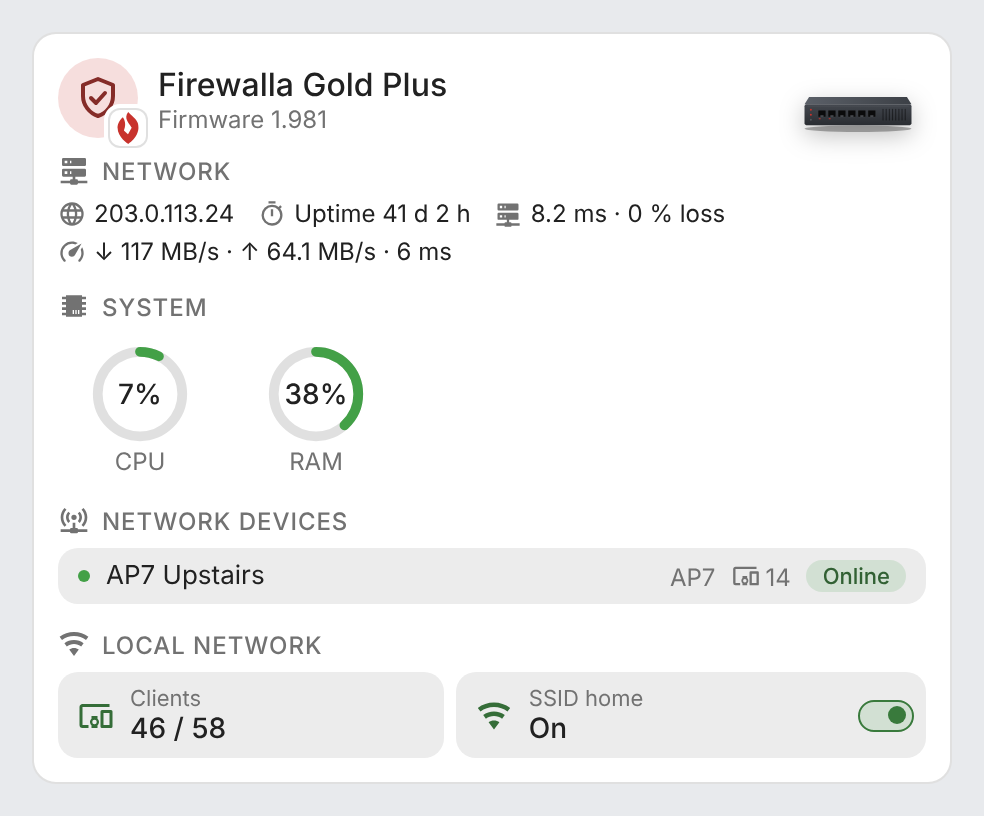 | 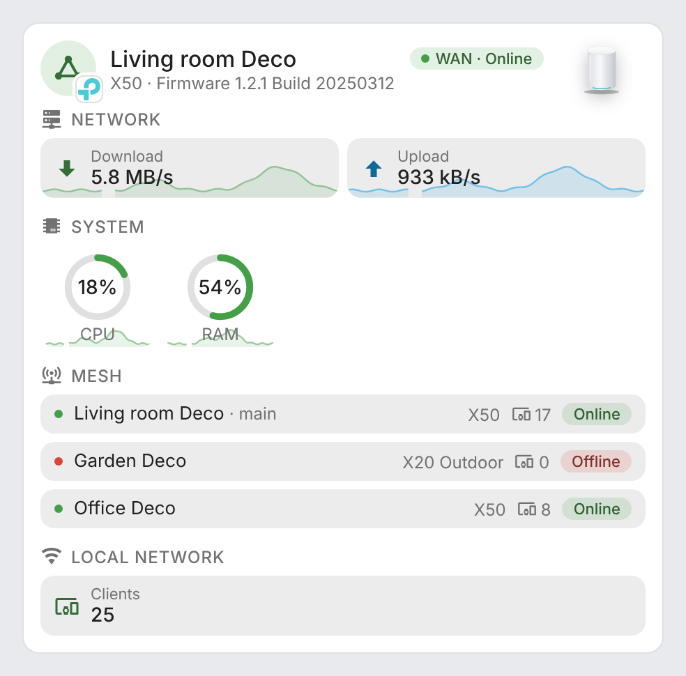 |

| OPNsense | ASUSWRT |
|---|---|
| 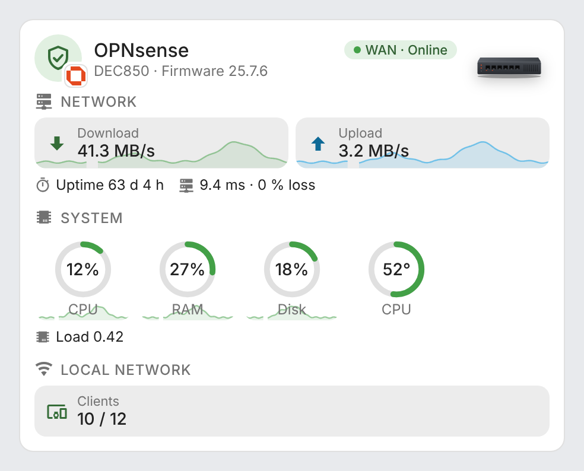 | 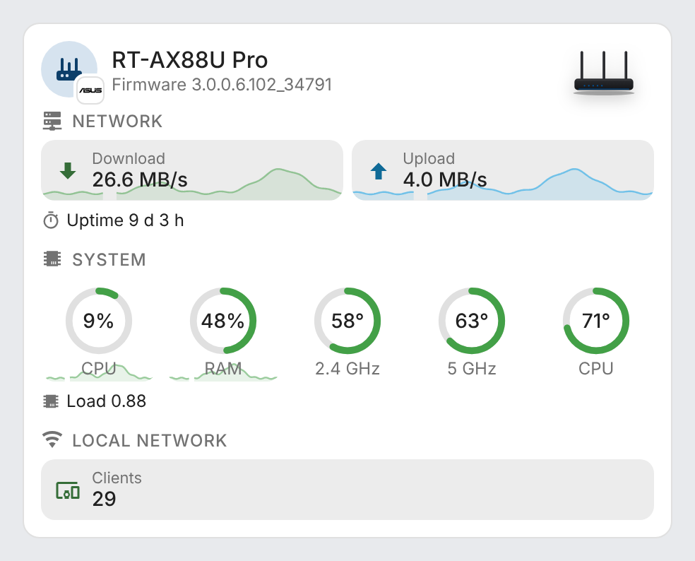 |

### Dark mode

| Router Card | Router Mini Card |
|---|---|
| 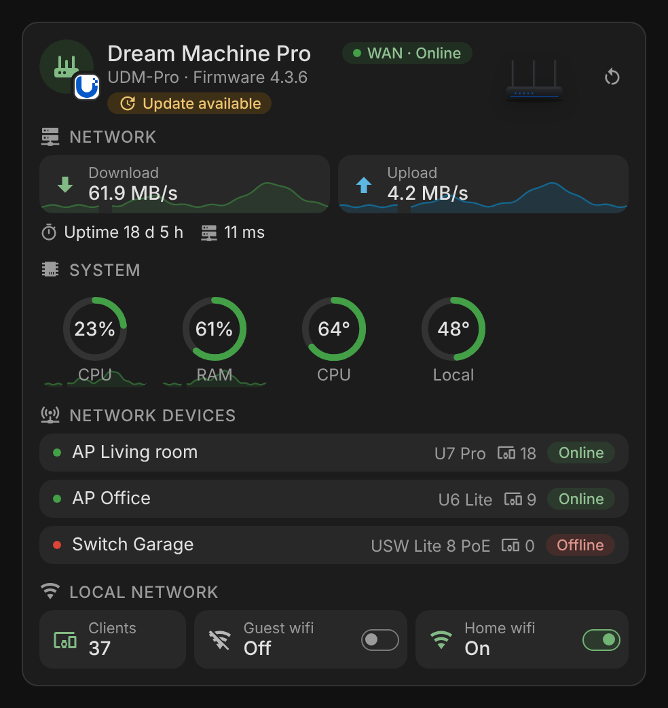 | 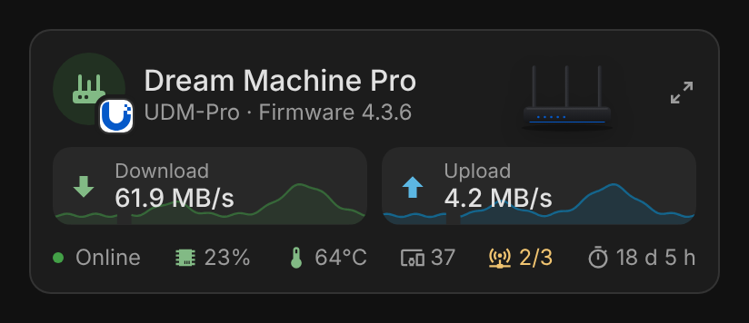 |

| Firewalla | TP-Link Deco |
|---|---|
| 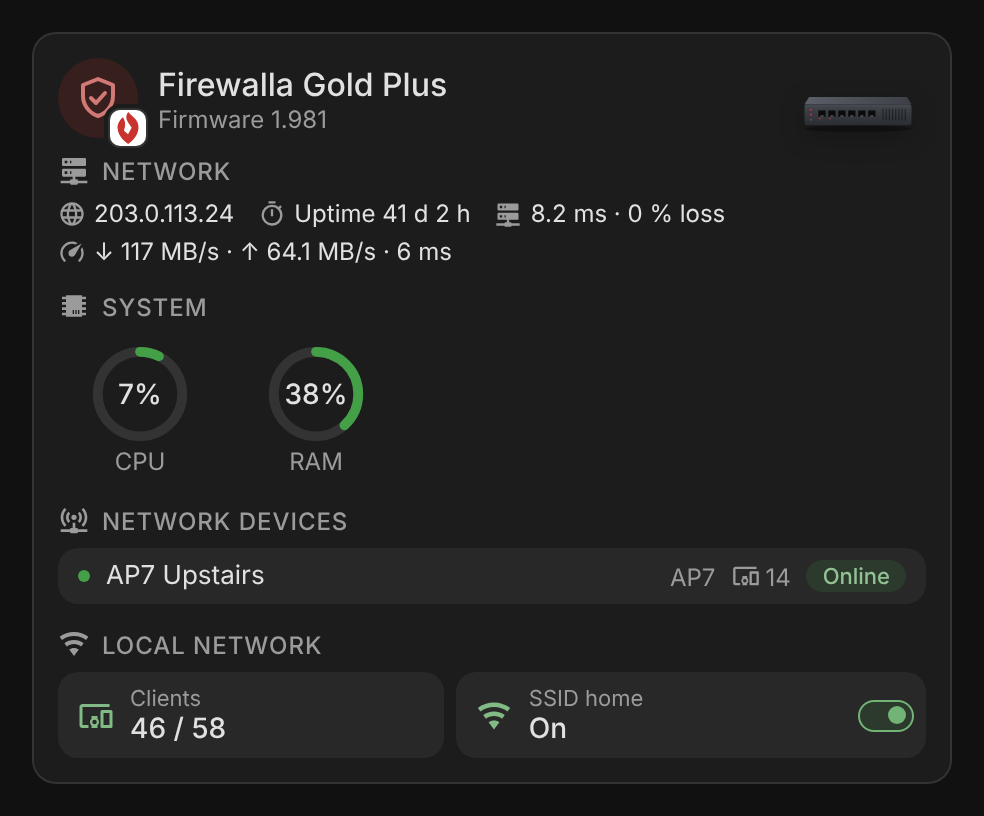 | 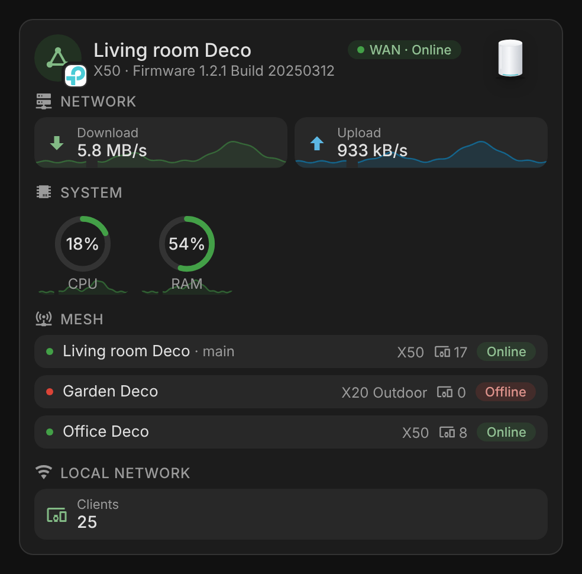 |

| OPNsense | ASUSWRT |
|---|---|
| 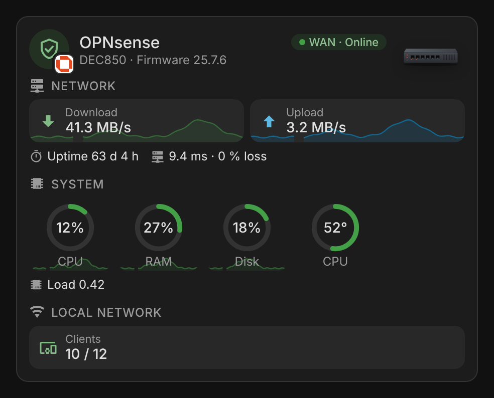 | 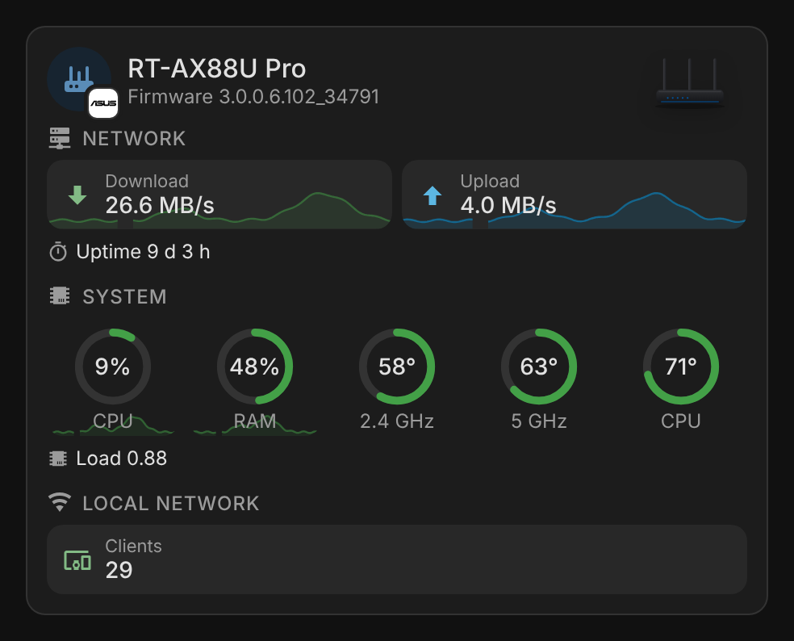 |

### Mini card

After a click on the detail button, the mini card shows the full card in its place:

| Light | Dark |
|---|---|
| 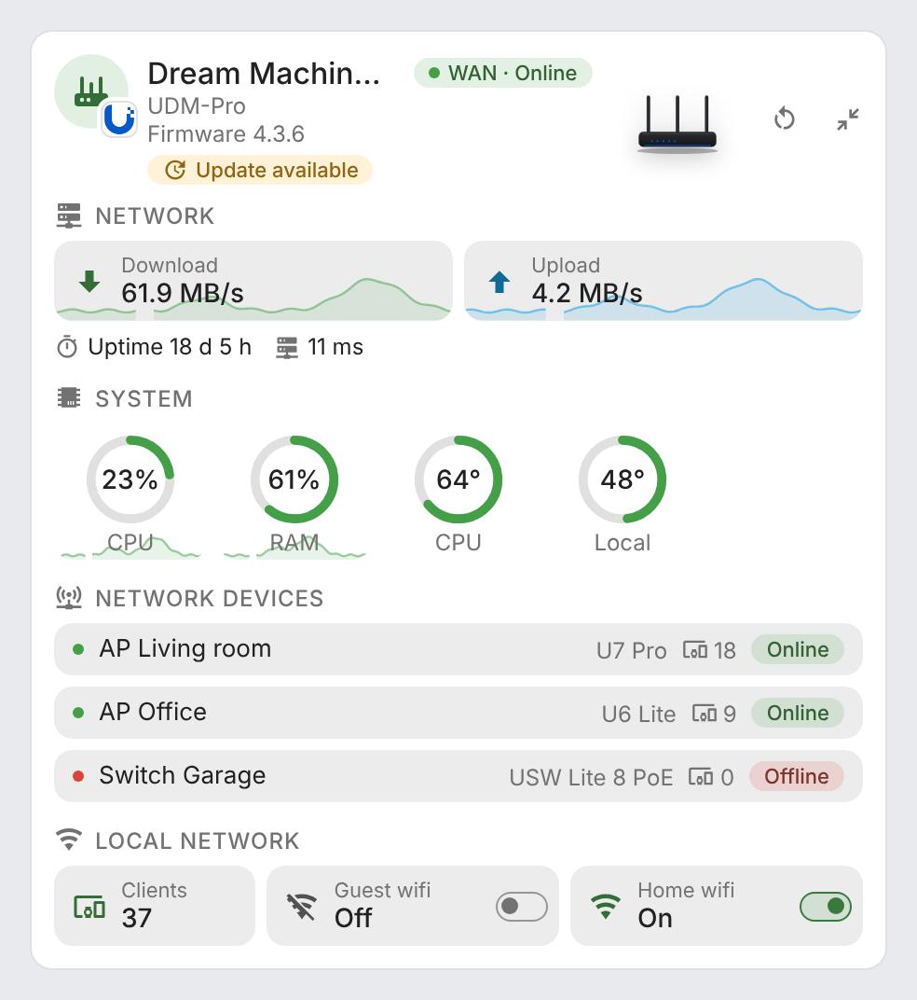 | 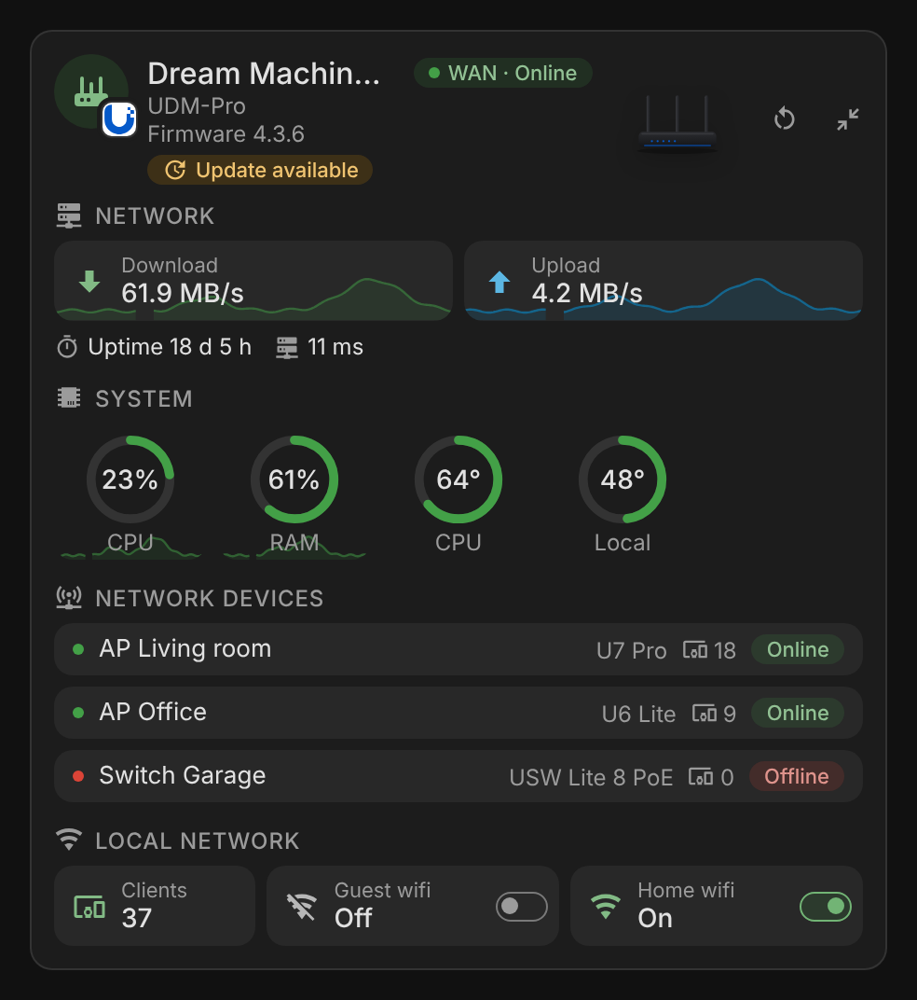 |

### Drawings

| Firewall | Router | Mesh unit | Access point |
|---|---|---|---|
|  | 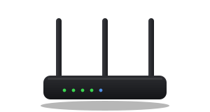 |  |  |

## How it works

The cards read the entity and device registries of Home Assistant. A device of a supported integration is a router when its entities tell its traffic, its WAN state or its system (CPU, RAM, uptime…); the editor lists them, the gateway first. Each value of the device is then found:

1. by the integration's own translation keys, when the card knows them (UniFi `device_cpu_utilization`, Omada `wan_link`, Linksys Velop `wan_status`…);
2. by the integration's attributes (Firewalla gives its CPU, RAM, uptime, WAN IP and hosts as attributes of its System Status sensor);
3. by the kind of entity and its words: a data-rate sensor whose key or entity id says `rx` / `in` / `download` is a download rate, a `%` sensor that says `cpu` is the CPU usage, a timestamp that says `uptime` / `boot` the boot date, a connectivity binary sensor that says `wan` / `internet` the WAN state… The integrations without translation keys name their entities in English, so their entity ids are English whatever the user's language; those with translation keys keep English keys in every language.

The WAN is preferred to the other interfaces (a rate that says `wan` or `internet` wins over `lan`, `guest` or `vpn`), totals to per-unit values (TP-Link Deco), smoothed values to raw ones, and the rates of an interface device of the router (MikroTik) are used when the router itself has none. A speed test result, a backhaul or a link speed is never taken for traffic.

The network devices are the other devices of the router's integration entry (UniFi access points and switches, Deco, eero and Velop units, Firewalla AP7) that tell their state or their clients; a device with a tracker is a client, not a unit. The clients are the integration's count, else the sum of its wired / Wi-Fi / guest counts, else its trackers at home. On a mesh system whose count is the main unit's own (Deco), the clients of every unit are added up.

Thresholds:

| Value | Orange | Red |
|---|---|---|
| CPU | 80 % | 95 % |
| RAM | 80 % | 90 % |
| Disk | 80 % | 90 % |
| Temperatures | 75 °C | 90 °C |

Temperatures are shown in the unit of their sensor (°F with the imperial unit system) and compared to these thresholds after conversion to °C.

## Development

```bash
npm install
npm run build        # bundles src/router-card.js + the embedded logos (images/*.svg) into dist/router-card.js
npm run check        # builds and checks the card (run in CI)
npm test             # unit and browser tests (Chromium through Playwright; CHROMIUM_PATH for a local one)
npm run screenshots  # renders the cards with mock data (scripts/mock-states.mjs) into screenshots/
```

`dist/` is not committed: `npm run build` creates it locally, CI builds it on every push, and the release workflow attaches the built file to the release, which is where the Marketplace installs it from.

### Releasing

1. Bump `version` in `package.json` (and `package-lock.json`: `npm install`)
2. Add a `## <version>` section at the top of [CHANGELOG.md](https://github.com/juju35/ha-router-card/blob/main/CHANGELOG.md)
3. Push to `main`: the **Release** workflow builds the card, creates the tag and the GitHub release with the changelog section as notes, and attaches `router-card.js` with its translation files

## Translations

The cards auto-detect the language from your Home Assistant settings. Currently supported:

| Language | Code |
|---|---|
| English | `en` |
| Français | `fr` |
| Deutsch | `de` |
| Español | `es` |
| Српски (Serbian, Cyrillic) | `sr` |
| Srpski (Serbian, Latin) | `sr-Latn` |
| Italiano | `it` |
| Nederlands | `nl` |
| Português (European) | `pt` |
| Polski | `pl` |
| Română | `ro` |
| Dansk | `da` |
| Svenska | `sv` |
| Български | `bg` |
| Русский | `ru` |
| Українська | `uk` |
| Magyar | `hu` |
| Slovenčina | `sk` |
| Čeština | `cs` |
| Slovenščina | `sl` |
| Latviešu | `lv` |
| Ελληνικά | `el` |

Contributions for additional languages are welcome!

## License

[MIT](https://github.com/juju35/ha-router-card/blob/main/LICENSE)

The brand names and logos belong to their owners (logos from [Simple Icons](https://simpleicons.org), CC0). This project is not affiliated with any of them.

## Support

If you find this project useful, you can support its development:

<a href="https://buymeacoffee.com/julienstep9"></a>
